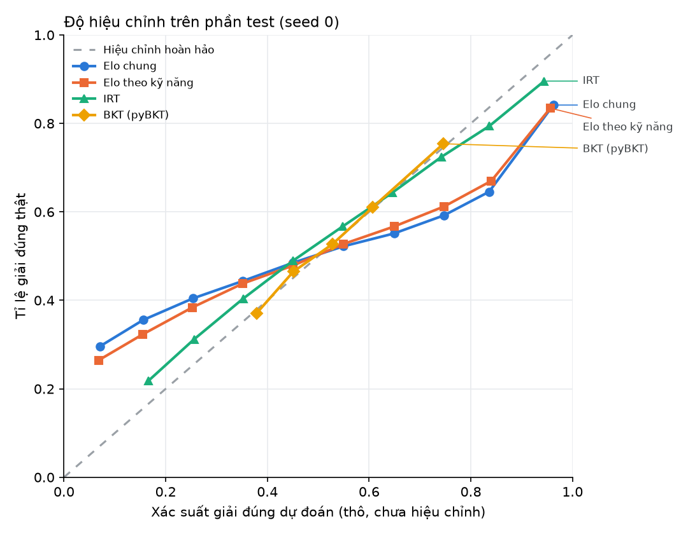

# E1: Lớp đánh giá 1, dự đoán đúng/sai trên dữ liệu thật

Ngày chạy: 15/11/2026. Ticket: #16. Dữ liệu và phép chia: [E0](e0-stanford.md).

**Kết luận**

1. **Elo theo kỹ năng hơn Elo chung và BKT trên cả ba chỉ số:** +1,9 điểm accuracy và khoảng +0,02 AUC. Theo dõi năng lực theo từng kỹ năng có ích, nên kết quả **ủng hộ ADR 0002**.
2. **IRT tốt nhất trên cả ba chỉ số:** 61,1%, AUC 0,659, log-loss 0,656. Lợi thế của IRT đến từ việc nó **học lại độ khó của từng bài tập**. Điều này hợp với ghi chú của bộ dữ liệu rằng rating bài tập Chess.com bị lệch.
3. **Xác suất thô của các mô hình Elo tự tin quá mức.** Khi Elo theo kỹ năng đoán p ≈ 0,70, tỉ lệ đúng thật chỉ là **0,59**. Đây là rủi ro trực tiếp cho buổi luyện (#5), vì buổi luyện nhắm vào p ≈ 0,7. Xem mục "Hệ quả cho app".

## Cách chạy lại

```sh
npm run data                       # ở thư mục gốc, nếu chưa có dữ liệu
cd backend
for m in elo skill_elo irt bkt; do for s in 0 1 2; do
  uv run python -m chesscoach.experiments.e1_layer1 predict --model $m --seed $s
done; done
uv run python -m chesscoach.experiments.e1_layer1 report        # bảng, độ hiệu chỉnh, biểu đồ
uv run python -m chesscoach.experiments.e1_layer1 distribution  # e1-skill-distribution.json
```

- **Thời gian chạy:** Elo chung, Elo theo kỹ năng và IRT mỗi lần dưới 40 giây. BKT (pyBKT) mất 72–80 phút mỗi seed, vì trên Windows pyBKT chạy bằng Python thuần; ba seed chạy song song được bằng ba tiến trình. Lần sau nên chạy BKT trong WSL hoặc Linux, vì ở đó pyBKT dịch được phần C++.
- **Phiên bản thư viện:** pyBKT 1.4 cần `numpy<2` và `scikit-learn<1.6`, đã ghim trong `backend/pyproject.toml`. App không dùng numpy lúc chạy; chỉ các thí nghiệm dùng.

## Bốn mô hình

Mọi mô hình dùng phép chia theo thời gian của E0: 872.867 lần giải train, 218.760 lần giải test. Thang rating là của Chess.com (`puzzle_rating_original`). Không dùng `puzzle_rating_ours` vì nó bị rò rỉ dữ liệu test (xem E0).

| Mô hình | Cách dự đoán |
| --- | --- |
| Elo chung | Module mô hình năng lực của app (`chesscoach.ability`), coi bài tập không có kỹ năng nào. Năng lực khởi tạo từ `pre_rating` của lần giải đầu. Dự đoán trực tuyến: đoán từng lần giải trước khi biết kết quả, rồi mới cập nhật |
| Elo theo kỹ năng | Cùng module, cùng cách chạy; kỹ năng lấy từ chủ đề Chess.com qua bản đồ kỹ năng của app |
| IRT 1PL | p = σ(θ người chơi − b bài tập + c), fit bằng Adam trên phần train. θ và b co về một tiên nghiệm lấy từ rating Chess.com, với độ dốc và hệ số chặn fit trên train (như baseline hiệu chỉnh của E0). θ giữ cố định khi dự đoán phần test |
| BKT | pyBKT, mỗi kỹ năng một mô hình (biết/chưa biết, học, đoán mò, trượt tay), fit trên phần train; dự đoán trực tuyến qua lịch sử. Lần giải nhiều kỹ năng: lấy trung bình dự đoán của các kỹ năng |

Chủ đề Chess.com được quy về kỹ năng bằng bảng `CHESSCOM_THEMES` trong `chesscoach.skills`, phần mở rộng của bản đồ kỹ năng:
- 44 chủ đề kỹ năng và 12 chủ đề mô tả. `Passed Pawns` được coi là chủ đề mô tả, vì nó gắn cho gần nửa số bài tập.
- Một số cách gán là phán đoán, ví dụ Sacrifice → dụ quân và thí quân, Zwischenzug → nước lặng và nước trung gian.
- Chess.com gắn ít nhãn chiến thuật, nên 51% bài tập (50% lần giải) chỉ có chủ đề mô tả và rơi vào kỹ năng "bỏ lỡ chiến thuật". Điều này làm yếu cả Elo theo kỹ năng lẫn BKT; trên bài tập Lichess, vốn có nhiều chủ đề hơn, lợi thế theo kỹ năng có thể lớn hơn.

## Kết quả

Trên phần test, mean ± std qua 3 seed (0, 1, 2). Bản "thô" là xác suất mô hình tự đưa ra. Bản "Platt" hiệu chỉnh lại bằng σ(a + b·logit p), với a, b fit trên dự đoán phần train của chính lần chạy đó.

| Mô hình | Accuracy | AUC | Log-loss | p trung bình |
| --- | ---: | ---: | ---: | ---: |
| *Mốc E0: rating Chess.com hiệu chỉnh* | *0,5577* | *0,5835* | *0,6834* | *0,511* |
| Elo chung (thô) | 0,5704 ± 0,0000 | 0,5999 ± 0,0000 | 0,7170 ± 0,0000 | 0,490 |
| Elo chung (Platt) | 0,5698 ± 0,0000 | 0,5999 ± 0,0000 | 0,6760 ± 0,0000 | 0,502 |
| Elo theo kỹ năng (thô) | 0,5885 ± 0,0000 | 0,6245 ± 0,0000 | 0,7030 ± 0,0000 | 0,492 |
| Elo theo kỹ năng (Platt) | 0,5888 ± 0,0000 | 0,6245 ± 0,0000 | 0,6678 ± 0,0000 | 0,501 |
| **IRT (thô)** | **0,6109 ± 0,0000** | **0,6587 ± 0,0000** | **0,6561 ± 0,0000** | 0,469 |
| IRT (Platt) | 0,6110 ± 0,0000 | 0,6587 ± 0,0000 | 0,6767 ± 0,0000 | 0,458 |
| BKT (thô) | 0,5696 ± 0,0018 | 0,6030 ± 0,0010 | 0,6767 ± 0,0000 | 0,498 |
| BKT (Platt) | 0,5712 ± 0,0007 | 0,6030 ± 0,0010 | 0,6767 ± 0,0000 | 0,504 |

**Seed chỉ thực sự có tác dụng ở BKT** (qua điểm khởi tạo của EM). Hai mô hình Elo tất định, và phép chia không đổi theo seed (xem E0), nên độ lệch chuẩn bằng 0 là đúng. Ở IRT, seed chỉ làm nhiễu rất nhỏ điểm khởi tạo, rồi tối ưu hội tụ về cùng một nghiệm. Yêu cầu "3 seed" vì thế chỉ có ý nghĩa với 1 trong 4 mô hình.

**Platt làm IRT kém đi** (log-loss 0,656 → 0,677), vì Platt được fit trên chính những dự đoán của phần train mà IRT đã khớp sát. Với IRT, bản thô là bản đúng để dùng.

**So sánh:**
- **Elo chung so với mốc E0:** tốt hơn trên cả ba chỉ số, nhờ cập nhật năng lực sau mỗi lần giải.
- **Elo theo kỹ năng so với Elo chung:** **+1,9 điểm accuracy, +0,025 AUC, −0,008 log-loss** (bản Platt). Đây là bằng chứng chính cho việc theo dõi năng lực theo từng kỹ năng.
- **Elo theo kỹ năng so với BKT:** **+1,9 điểm accuracy, +0,022 AUC, −0,009 log-loss**. BKT không biết độ khó bài tập: một bài tập fork rating 800 và một bài tập fork rating 2.000 được đoán như nhau.
- **IRT so với Elo theo kỹ năng:** +2,2 điểm accuracy, +0,034 AUC. IRT học một độ khó riêng cho từng bài tập trong 76.965 bài tập, trong khi các mô hình Elo dùng thẳng rating Chess.com (bị lệch). IRT không có năng lực theo kỹ năng, và θ của nó đứng yên.

### Độ hiệu chỉnh



Biểu đồ vẽ **xác suất thô**, đúng là thứ mỗi mô hình đưa ra. Bảng số (seed 0; chỉ các khoảng có từ 500 lần giải; dạng: p dự đoán → tỉ lệ đúng thật):

| Mô hình | Các khoảng p (số lần giải) |
| --- | --- |
| Elo chung (thô) | 0,07 → 0,30 (4.564); 0,16 → 0,36 (15.306); 0,25 → 0,40 (24.797); 0,35 → 0,44 (32.891); 0,45 → 0,48 (35.634); 0,55 → 0,52 (34.134); 0,65 → 0,55 (31.656); 0,75 → 0,59 (25.810); 0,84 → 0,65 (10.371); 0,96 → 0,84 (3.597) |
| Elo theo kỹ năng (thô) | 0,07 → 0,26 (5.733); 0,15 → 0,32 (17.023); 0,25 → 0,38 (25.123); 0,35 → 0,44 (30.465); 0,45 → 0,48 (33.768); 0,55 → 0,53 (32.939); 0,65 → 0,57 (30.727); 0,75 → 0,61 (25.204); 0,84 → 0,67 (13.730); 0,96 → 0,83 (4.048) |
| Elo theo kỹ năng (Platt) | 0,27 → 0,26 (4.636); 0,36 → 0,34 (28.722); 0,45 → 0,45 (74.621); 0,55 → 0,55 (77.503); 0,63 → 0,64 (28.987); 0,74 → 0,78 (2.458); 0,85 → 0,91 (1.225) |
| IRT (thô) | 0,17 → 0,22 (8.573); 0,26 → 0,31 (27.385); 0,35 → 0,40 (42.811); 0,45 → 0,49 (48.224); 0,55 → 0,57 (42.545); 0,65 → 0,64 (29.441); 0,74 → 0,72 (14.332); 0,84 → 0,79 (3.915); 0,94 → 0,90 (1.199) |
| BKT (thô) | 0,38 → 0,37 (52.413); 0,45 → 0,47 (24.645); 0,53 → 0,53 (102.576); 0,61 → 0,61 (37.433); 0,75 → 0,75 (1.175) |

- **Elo chung và Elo theo kỹ năng tự tin quá mức.** Xác suất thô trải quá rộng: đoán 0,07 thì thật là 0,26–0,30; đoán 0,75 thì thật chỉ 0,59–0,61.
  - Trung bình p vẫn ≈ 0,49, vì θ tự giảm về đúng mức sau vài lần giải; nhưng độ trải thì sai.
  - Hệ số Platt của Elo theo kỹ năng là b ≈ 0,38: chênh rating dự báo kết quả yếu hơn khoảng 2,6 lần so với công thức Elo giả định. Hiệu chỉnh xong thì log-loss giảm 0,035, nhiều hơn khoảng cách giữa bất kỳ hai mô hình nào.
- **IRT bám sát đường chéo** khi tiên nghiệm dùng độ dốc fit trên train. Bản trước dùng độ dốc 400/ln 10 nên tự tin quá mức (đoán 0,07 thì thật là 0,26).
- **BKT hiệu chỉnh gần như hoàn hảo nhưng dè dặt:** mọi dự đoán nằm trong khoảng 0,38–0,75, nên phân biệt được ít.

## Hệ quả cho app

1. **Buổi luyện (#5) không được dùng thẳng p thô để nhắm 0,7.** Trên bộ dữ liệu này, để có tỉ lệ đúng thật 0,70, Elo theo kỹ năng phải đoán p thô ≈ 0,90.
   - Thang Lichess có thể khác: rating bài tập Lichess được tính bằng Glicko-2 trên hàng triệu lần giải, nên có lẽ đã hiệu chỉnh tốt hơn rating bài tập Chess.com.
   - Đề xuất: thêm vào mô hình năng lực một bước hiệu chỉnh p' = σ(a + b·logit p). Mặc định a = 0, b = 1, rồi fit lại a, b từ chính lịch sử lần giải trong app khi đủ dữ liệu. Báo cáo thêm cả độ hiệu chỉnh của buổi luyện.
2. **Độ khó từng bài tập quan trọng.** IRT thắng nhờ học lại độ khó. App dùng rating bài tập Lichess vốn được tính từ rất nhiều lần giải, nên cái lợi này có lẽ nhỏ hơn trong app. Nhưng nếu muốn, có thể thêm một độ lệch độ khó theo bài tập, học từ lần giải trong app.
3. **Hằng số K và σ của mô hình năng lực nên tinh chỉnh** trên một phần tách ra từ train (không dùng phần test). Đặc biệt, có thể giảm K hoặc tăng thang s để bớt độ trải.

## Phân bố năng lực cho lớp 3

`e1-skill-distribution.json` ghi phân bố năng lực sau lần giải cuối của từng người chơi, theo mô hình Elo theo kỹ năng (tạo bằng lệnh `distribution`):
- năng lực chung θ: trung bình 1.488, độ lệch chuẩn 365 (thang Chess.com, 1.068 người chơi);
- độ lệch θₖ (đã co) của từng kỹ năng: chỉ tính người chơi có ít nhất 10 lần giải ở kỹ năng đó; độ lệch chuẩn khoảng 40–80 rating.

**Đây là ước lượng điểm, không phải phân bố ẩn thật.** θₖ đã bị co về 0, nên độ lệch chuẩn bị nén nhỏ lại; đồng thời nó lẫn cả nhiễu ước lượng. File chưa có tương quan giữa θ và θₖ, và các tham số BKT đã fit (prior, learn, guess, slip theo kỹ năng) chưa được lưu. Khi làm người học mô phỏng ở lớp 3 (#19), nên fit và lưu tham số BKT; và dùng độ lệch chuẩn ở đây như một cận dưới của độ trải năng lực giữa các kỹ năng, kèm phân tích độ nhạy.

## Giới hạn

- Thang rating là của Chess.com, không phải thang rating bài tập Lichess như ADR 0003. Kết quả đánh giá *cấu trúc* của mô hình, không đánh giá con số θ trong app.
- Phép chia theo thời gian trong từng người chơi, không theo thời gian chung. Vì vậy độ khó bài tập của IRT và tham số BKT được học cả từ những lần giải của người khác diễn ra *sau* lần giải test của một người. Đây là lựa chọn thiết kế của E0, nhưng có lợi hơi nhiều cho IRT và BKT.
- `puzzle_rating_original` là một ảnh chụp duy nhất cho mỗi bài tập, có thể đã gồm kết quả của những lần giải về sau (xem E0).
- Trọng số co của IRT (1,25) được chọn trước, không tinh chỉnh.
- DKT chưa làm; nó nằm trong tuần đệm.
