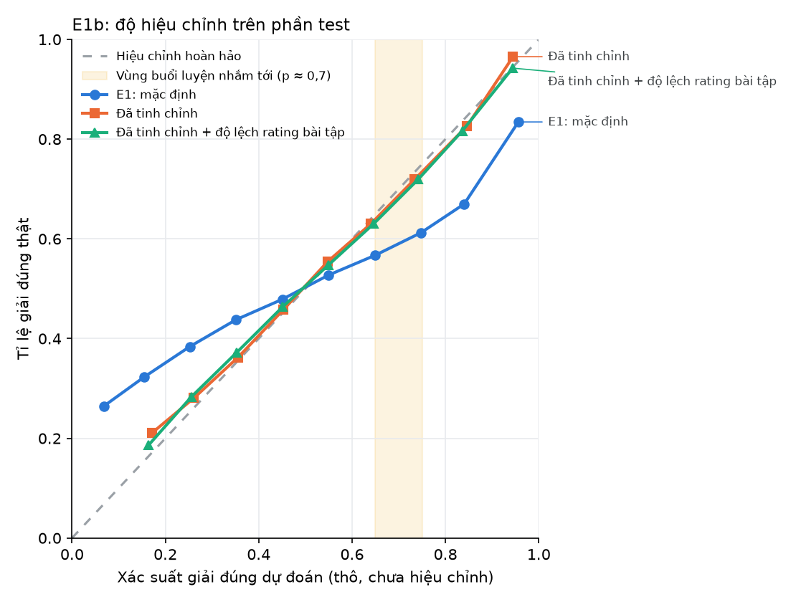

# E1b: Tinh chỉnh và hiệu chỉnh mô hình năng lực

Ngày chạy: 15/11/2026. Ticket: #21 (thí nghiệm), #22 (đưa vào app). Dữ liệu: bộ Stanford như [E0](e0-stanford.md) và [E1](e1-layer1.md).

**Kết luận**

1. **Lỗi tự tin quá mức của E1 nằm ở thang s.** Sau khi tinh chỉnh (thang s gấp 3 lần Elo, K lớn lúc đầu rồi giảm sâu), xác suất thô khớp tỉ lệ đúng thật: đoán 0,73 thì đúng 0,72, không còn cần hiệu chỉnh Platt.
2. **Thêm độ lệch rating theo từng bài tập** (Elo hai chiều) đưa mô hình lên **62,1% accuracy, AUC 0,670, log-loss 0,646**, vượt mọi mô hình của E1, kể cả IRT (61,1%, 0,659, 0,656). Khi δ không được học từ phần test, mô hình vẫn đạt 61,9%, 0,667 và 0,648.
3. **App dùng cấu hình đã tinh chỉnh làm mặc định**, cộng thêm một bước hiệu chỉnh xác suất học từ dữ liệu của chính app (#22). Phần độ lệch rating theo bài tập *chưa* đưa vào app; lý do ở mục "Áp dụng vào app".

## Cách làm

- **Validation:** 20% lần giải cuối trong phần train của mỗi người chơi (175.004 lần giải). Mọi lựa chọn chỉ dựa trên validation. Phần test (218.760 lần giải) chỉ được đo một lần, ở cuối.
- **Tiêu chí chọn:** log-loss trên validation, sau hiệu chỉnh Platt fit trên phần train còn lại. Lý do: app có bước hiệu chỉnh riêng, nên điều cần tối ưu là mô hình xếp hạng và thích nghi tốt, còn độ dốc xác suất thì hiệu chỉnh sau.
- **Thứ tự thời gian chung:** mọi lần giải được duyệt theo thời gian chung của mọi người chơi, nên độ lệch rating của bài tập chỉ học từ những lần giải *trước đó*.
- **Khi tinh chỉnh, δ không học từ lần giải thuộc phần test.** Lần giải test của người chơi khác có thể xảy ra trước một lần giải validation; nếu δ học từ chúng thì nhãn test sẽ lọt vào việc chọn cấu hình. Bản đầu của E1b mắc lỗi này (code review phát hiện); sau khi sửa, cấu hình được chọn không đổi.
- **Giai đoạn 1:** lưới 320 cấu hình của `AbilityConfig`:
  - thang s ×1–×5;
  - K chung bắt đầu từ 32–256, mức sàn 8 hoặc 16;
  - K kỹ năng bắt đầu từ 24–192;
  - độ co 2 hoặc 5.
- **Giai đoạn 2:** độ lệch rating δ theo bài tập. δ bị trừ K·(y − p) sau mỗi lần giải; khi dự đoán dùng rating bài tập + δ·n/(n + độ co). Lưới 15 cấu hình: K bắt đầu từ 32–512, độ co 1–5.

```sh
cd backend
uv run python -m chesscoach.experiments.e1b_tuning          # khoảng 27 phút trên 14 lõi
uv run python -m chesscoach.experiments.e1b_tuning --reuse-stage1   # chỉ chạy lại giai đoạn 2–3
uv run python -m chesscoach.experiments.e1b_tuning --plot   # vẽ lại biểu đồ từ e1b-results.json
```

Toàn bộ kết quả (mọi cấu hình, điểm validation, hệ số Platt) nằm trong `e1b-results.json`.

## Tinh chỉnh trên validation

Cấu hình tốt nhất ứng với mỗi thang s (log-loss sau Platt; b là độ dốc Platt cần thêm, b = 1 nghĩa là xác suất thô đã đúng độ dốc):

| Thang s | Log-loss sau Platt | Log-loss thô | AUC | K chung | K kỹ năng | Độ co | b của Platt |
| --- | ---: | ---: | ---: | --- | ---: | ---: | ---: |
| ×1 (E1: K 64/16, 48/8, co 2) | 0,6697 | 0,7070 | 0,6201 | 64 → 16 | 48 | 2 | 0,37 |
| ×1 | 0,6676 | 0,7076 | 0,6251 | 256 → 8 | 192 | 5 | 0,38 |
| ×2 | 0,6636 | 0,6667 | 0,6338 | 256 → 8 | 192 | 5 | 0,67 |
| **×3** | **0,6627** | **0,6627** | **0,6355** | 256 → 8 | 192 | 2 | 0,85 |
| ×4 | 0,6631 | 0,6630 | 0,6346 | 256 → 8 | 192 | 2 | 0,96 |
| ×5 | 0,6638 | 0,6640 | 0,6328 | 256 → 8 | 192 | 2 | 1,04 |

- **Thang s ×3 tốt nhất, và nằm ở giữa lưới.** Lưới đầu tiên chỉ thử tới ×3; lưới mở rộng ×4 và ×5 cho thấy đây là điểm tối ưu thật, không phải do lưới bị cắt.
- **K bắt đầu càng lớn càng tốt, nhưng gần như đã bão hòa.** Ở thang ×3, từ 64 lên 128 cải thiện 0,0007 log-loss, từ 128 lên 256 chỉ còn 0,0002. K lớn lúc đầu giúp năng lực rời mức khởi tạo nhanh; sau đó K giảm theo 1/√(1 + n/4) xuống mức sàn 8.
- **Độ co của θₖ gần như không ảnh hưởng:** ở thang ×3, từ 2 lên 5 đổi khoảng 0,00001.
- **Độ lệch rating theo bài tập (giai đoạn 2):** tốt nhất là K bắt đầu từ 256, mức sàn 32, độ co 2, với log-loss trên validation 0,6497 và AUC 0,6631. Điểm này nằm giữa lưới: K = 512 kém hơn.

## Kết quả trên phần test

Đo một lần cho các cấu hình đã chọn. Bản Platt fit trên toàn bộ phần train (gồm cả validation).

| Cấu hình | Accuracy | AUC | Log-loss thô | Log-loss sau Platt | p ≈ 0,7 → tỉ lệ đúng thật (thô) |
| --- | ---: | ---: | ---: | ---: | ---: |
| E1: Elo theo kỹ năng, mặc định | 0,5885 | 0,6245 | 0,7030 | 0,6678 | 0,75 → 0,61 |
| Tinh chỉnh K, giữ thang chuẩn | 0,5910 | 0,6281 | 0,7044 | 0,6663 | 0,75 → 0,61 |
| **Tinh chỉnh (thang ×3), cấu hình mặc định mới của app** | **0,5993** | **0,6381** | **0,6616** | 0,6616 | **0,73 → 0,72** |
| **Tinh chỉnh + độ lệch rating bài tập** | **0,6211** | **0,6704** | **0,6461** | 0,6455 | 0,74 → 0,72 |
| … nhưng δ không học từ phần test | 0,6194 | 0,6670 | 0,6481 | 0,6475 | 0,74 → 0,72 |
| *E1: IRT, để so* | *0,6109* | *0,6587* | *0,6561* | | |



Hai cấu hình đã tinh chỉnh bám sát đường chéo trên toàn dải, kể cả vùng p ≈ 0,7 mà buổi luyện nhắm tới. Platt gần như không cải thiện thêm (0,6616 → 0,6616 và 0,6461 → 0,6455), nghĩa là xác suất thô đã đúng.

Dòng có δ học cả từ phần test là cách dùng thật khi app chạy: dự đoán trước, rồi học từ lần giải vừa xong, kể cả của người chơi khác. Dòng không học từ phần test là mức thấp hơn nhưng chặt hơn, để so công bằng với IRT của E1.

## Áp dụng vào app (#22)

- **Mặc định mới của `AbilityConfig`:** thang s = 3 × 400/ln 10; K chung 256 → 8; K kỹ năng 192 → 4; độ co 2. Cấu hình cũ được giữ thành `E1_CONFIG`, để chạy lại E1 vẫn ra đúng số trong báo cáo.
- **Vì sao không giữ thang chuẩn của Elo:** rating Chess.com cũng do Glicko tính với thang chuẩn, vậy mà trên dữ liệu thật chênh rating chỉ dự báo kết quả bằng khoảng 0,37 lần mức công thức giả định. Nhiều khả năng là do nhiễu của rating. Rating Lichess có lẽ cũng như vậy, nhưng chưa đo; đây là bằng chứng duy nhất nhóm có.
- **Lưới an toàn: hiệu chỉnh p' = σ(a + b·logit p) học từ mọi lần giải đã có nhãn trong app.**
  - Bật khi có từ 200 lần giải trở lên (`CHESSCOACH_CALIBRATION_MIN_ATTEMPTS`), luôn kéo về (a = 0, b = 1).
  - Mỗi request chỉ đếm số lần giải; fit lại khi số lần giải tăng ít nhất 10% (tối thiểu 50), có khóa khi nhiều request chạy song song.
  - Xác suất đã hiệu chỉnh dùng cho `predicted_p` của lần giải và sẽ dùng cho buổi luyện (#5). Hồ sơ kỹ năng không hiển thị xác suất nên không bị ảnh hưởng. Năng lực θ vẫn cập nhật bằng xác suất thô, để hiệu chỉnh không tự ảnh hưởng ngược lên chính nó.
  - Nếu thang ×3 sai với rating Lichess, bước này sẽ sửa dần khi app có dữ liệu.
  - Đã kiểm tra phép fit Python thuần của app với Platt viết bằng numpy trên 100.000 dự đoán thật: b = 0,3732 so với 0,3721.
- **Độ lệch rating theo bài tập chưa đưa vào app**, dù là cải thiện lớn nhất (+2,2 điểm accuracy, +0,032 AUC):
  - Trên bộ Stanford, lợi ích đến từ việc rating bài tập Chess.com bị lệch, và mỗi bài tập có nhiều người giải.
  - Trong app, rating bài tập Lichess đã được tính từ hàng triệu lần giải, còn app chỉ có vài người chơi, nên không đủ dữ liệu để học thêm độ lệch.
  - Nên mở lại khi app có nhiều người chơi.
- **Ảnh hưởng tới người chơi:**
  - Năng lực thay đổi mạnh ở những lần giải đầu. Ví dụ người chơi mới giải đúng bài tập rating 1539 thì năng lực từ 1500 lên 1633; giải đúng thêm bài tập rating 800 thì chỉ tăng 29.
  - Năng lực ổn định dần sau vài chục lần giải.
  - Xác suất dự đoán ít cực đoan hơn: bài tập rating 1699 với người chơi mới được đoán 0,41 thay vì 0,24.

## Giới hạn

- **Tất cả là trên thang và dữ liệu Chess.com.** Trên Lichess có thể khác; bước hiệu chỉnh của app có mặt chính để bù cho điều này. Thang s ×3 đã được ghi thành phụ lục của ADR 0003.
- **`Ability.theta` mặc định 1500** kể cả khi truyền cấu hình khác; `initial_theta` của cấu hình chỉ là thông tin. Mọi cấu hình đang dùng đều có `initial_theta` = 1500 nên chưa gây sai.
- **Lưới chỉ tinh chỉnh từng phần:** k_decay, mức sàn và độ bất định σ giữ cố định; K kỹ năng luôn bằng nửa K chung ở mức sàn.
- **Dừng tăng K bắt đầu ở 256**, vì phần lợi từ 128 lên 256 đã gần như bằng 0.
- **Giới hạn của phép chia theo thời gian trong từng người chơi ở E0/E1 vẫn còn**, dù độ lệch rating bài tập ở đây đã học theo thời gian chung.
